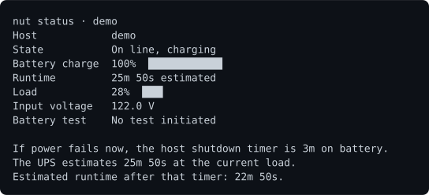

# nut

A Rust CLI that manages, checks, and proves [Network UPS Tools](https://networkupstools.org/)
protection. Cargo package: `nut-cli`; executable: `nut`; library: `nut_cli`.



The screenshot is a committed capture of `just demo` with `--color never`. Regenerate it
with `just screenshot`. The text form lives in [`docs/screenshot.txt`](docs/screenshot.txt).

## Quickstart

```sh
just check
just demo
cargo run --locked -- --help
```

`just demo` starts a loopback fake upsd and prints `nut status` against a committed
fixture. No UPS hardware is required. See [getting started](docs/getting-started.md) to
install on a real machine.

## Safety

NUT daemons, `upssched`, and a tiny rendered shell hook own the outage path. These six
rules apply to every command:

1. **Management plane only.** No `CMDSCRIPT`, `NOTIFYCMD`, or `SHUTDOWNCMD` may invoke
   this binary. Protection must continue when `nut` is missing or broken.
2. **Reads by default.** Writes are planned, diffed, backed up, and confirmed. `doctor`
   never fixes anything; every warning names an exact remedy.
3. **Agents cannot trigger power events.** `nut drill *`, `nut bios setup`, and
   `nut battery test` need an interactive terminal. Drills and BIOS setup also need the
   hostname typed back and refuse `--yes`.
4. **Protect secrets.** Passwords never enter argv, logs, diffs, verbose output, or JSON.
5. **Keep recipes offline.** Build and test recipes never touch a real UPS or contact
   another host implicitly. Recipes that reach a host take that host as a required
   argument.
6. **Claims need evidence.** Unknown state is stated plainly, with the command that
   would let `nut` know.

See [the complete safety contract](docs/safety.md).

## Commands

`nut --help` groups commands by workflow. Bare `nut` runs `status`.

| Group | Commands |
| --- | --- |
| Monitor | `status`, `battery`, `events` |
| Act | `beeper`, `notify` |
| Set up | `init`, `rollback`, `config` |
| Prove | `doctor`, `bios`, `drill` |
| Shell | `completion` |

Generated help lives in [CLI reference](docs/reference/cli/index.md). Man pages live in
[`man/`](man/) (`man nut`, `man nut-doctor`).

## Install on a new machine

```sh
just install-smoke
just install
nut config new -o nut.toml
nut --config ./nut.toml init --dry-run
```

`just install` builds a release binary, installs it root-owned at `/usr/local/bin/nut`,
installs the man pages, and installs completion as the user. It calls `sudo`. Agents
must submit the same argv through `/sase_sudo`. Continue with
[getting started](docs/getting-started.md).

Tagged GitHub Releases attach a static `x86_64-unknown-linux-musl` binary and SHA-256
checksum. Cut `v0.1.0` only after athena adoption.

## Docs

- [Getting started](docs/getting-started.md)
- [Design language](docs/design.md)
- [Architecture](docs/architecture.md)
- [Safety](docs/safety.md)
- [Configuration](docs/configuration.md)
- [Outage timeline](docs/outage-timeline.md)
- [BIOS guidance](docs/bios.md) and [adding a board](docs/adding-a-board.md)
- [Drills](docs/drills.md)
- [Doctor checks](docs/doctor-checks.md) (generated)
- [Init and rollback](docs/init.md)
- [Authenticated actions](docs/actions.md)
- [Completion](docs/completion.md)
- [Development](docs/development.md)

Generic hardware profiles belong here; machine-specific policy belongs in the host's
configuration repository. Licensed under [MIT](LICENSE).
