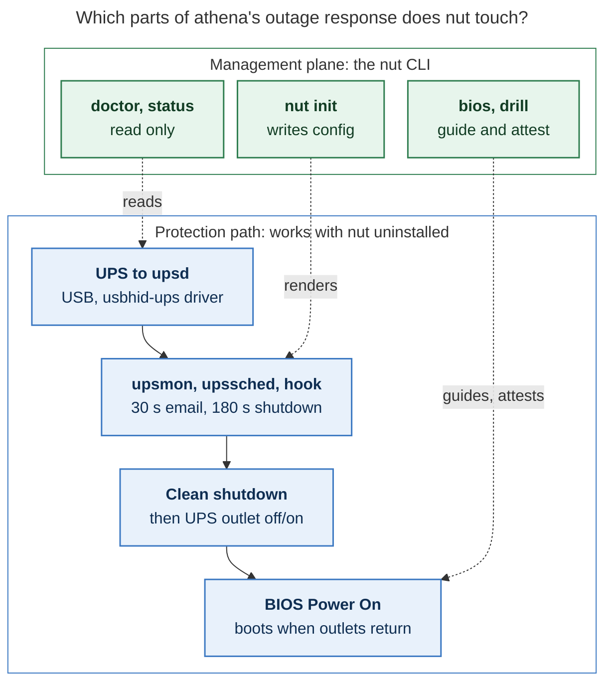

# Architecture

`nut` is a management plane beside Network UPS Tools. NUT's daemons, `upssched`, and a
tiny rendered shell hook own the outage path. Nothing in that path invokes `nut`. If the
binary is missing or broken, the host still shuts down cleanly.

One Cargo package, `nut-cli`, with binary `nut` and library `nut_cli`. It is synchronous
Rust with no async runtime. The library declares `#![forbid(unsafe_code)]`.

Host policy versus hardware knowledge: UPS and board profiles are generic data in this
repo. Machine choices (timers, mounts, mail, operators, battery date) live in a host
config that the machine's configuration repository owns. This repo never contains a
real mailbox or athena-only secrets. Golden fixtures are redacted.

## Figure 1. Which parts of an outage response does nut touch?

_Figure 1. Everything in the blue box runs during an outage, and none of it calls `nut`.
The green box writes files ahead of time, reads state, and records evidence. A broken
`nut` build can make the terminal ugly; it cannot stop a clean shutdown._

## Modules

- `cli/`: the clap derive tree, the grouped help renderer, and dispatch.
- `ui/`: theme, glyphs, formatting, bars, layout, and tables.
- `host/`: a `Host` trait for filesystem, process, clock, env, euid, TTY, and hostname.
- `upsd/`: the RFC 9271 client and the loopback-only fake upsd.
- `config/`, `profiles/`, `render/`, `init/`, `doctor/`, `firmware/`, `drill/`,
  `actions/`, `completion/`, `journal/`.

Machine paths: `/usr/local/bin/nut` (root-owned), `/etc/nut-cli/nut.toml`,
`/etc/nut-cli/operator.secret`, `/var/lib/nut-cli/`, `/var/backups/nut-cli/<UTC stamp>/`,
the hook `/usr/local/sbin/nut-upssched-cmd`, and per-user completion state under
`~/.local/state/nut-cli/`.

## Related

- [Design language](design.md)
- [Safety contract](safety.md)
- [Outage timeline](outage-timeline.md)
- [Init and rollback](init.md)
- [Development](development.md)
